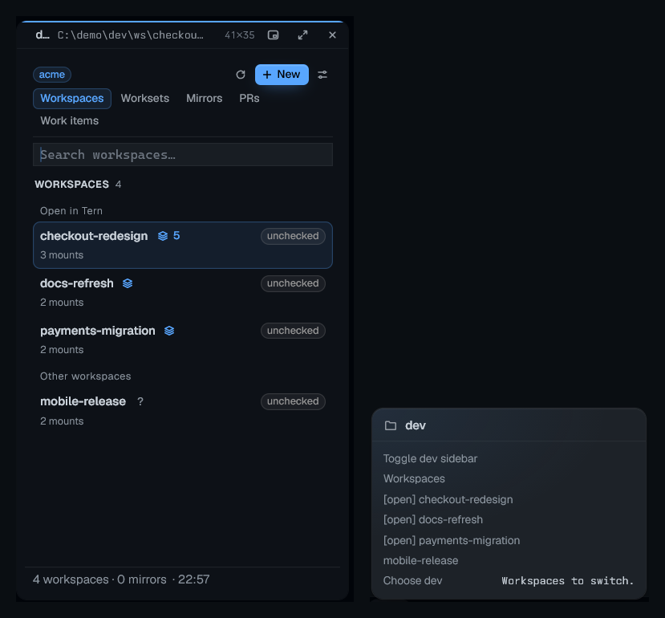

# dev for Tern

A native [Tern](https://tern.so) plugin for the [`dev`](https://github.com/gabrielmoreira/dev-cli) CLI.
Browse workspaces, mirrors, files, pull requests and work items from a sidebar, and jump between
workspaces without leaving your terminal.

<p align="center">
  
</p>

## Features

- **Sidebar navigator.** A native block that follows your tabs. Close it with its X and it stays closed.
- **Status bar widget.** Click to toggle the sidebar. Hover to preview every registered workspace,
  with the ones open in this window listed first.
- **Workspace switcher.** `dev: Workspaces` lists workspaces from all registered roots and focuses
  the tab where one is already open instead of opening a duplicate.
- **Guided actions.** Create workspaces, search mirrors, check remotes and review pull requests
  through forms, all backed by `dev`.

## Requirements

- Tern with plugin support
- The [`dev` CLI](https://github.com/gabrielmoreira/dev-cli) installed. Run `dev doctor` to check its prerequisites.

## Install

```sh
tern plugin install github.com/gabrielmoreira/dev-tern-plugin
```

Update with `--force`:

```sh
tern plugin install github.com/gabrielmoreira/dev-tern-plugin --force
```

Then add the **dev** widget from Tern's widget editor.

## Usage

| Command | What it does |
| --- | --- |
| `dev: Open` (`Ctrl+Alt+Shift+D`) | Open or toggle the navigator |
| `dev: Toggle sidebar` | Show or hide the sidebar |
| `dev: Workspaces` | Pick any registered workspace |
| `dev: Go to workspace` | Jump to a workspace |
| `dev: New workspace` | Create a workspace |
| `dev: Search mirrors` | Search repository mirrors |
| `dev: Check workspace remotes` | Check remotes for a workspace |
| `dev: Reload workspaces` | Refresh the list |
| `dev: Settings` | Sidebar side, surface and more |
| `dev: Execution environment` | Choose how `dev` and Git find their tools |

## How `dev` is found

The plugin looks for the `dev` executable in this order:

1. `DEV_TERN_BIN`, if set
2. `PATH`
3. The configured [mise](https://mise.jdx.dev) shim, then the newest mise install

If Tern starts with a different `PATH` than your shell, use `dev: Execution environment` to run
tools from an initialized shell.

## Development

Tests run with [Lune](https://github.com/lune-org/lune) against a real `dev` binary:

```sh
DEV_TERN_BIN=/path/to/dev lune run test/widget.luau
```

Each file in `test/` is a standalone scenario.

## License

No license has been chosen yet.
